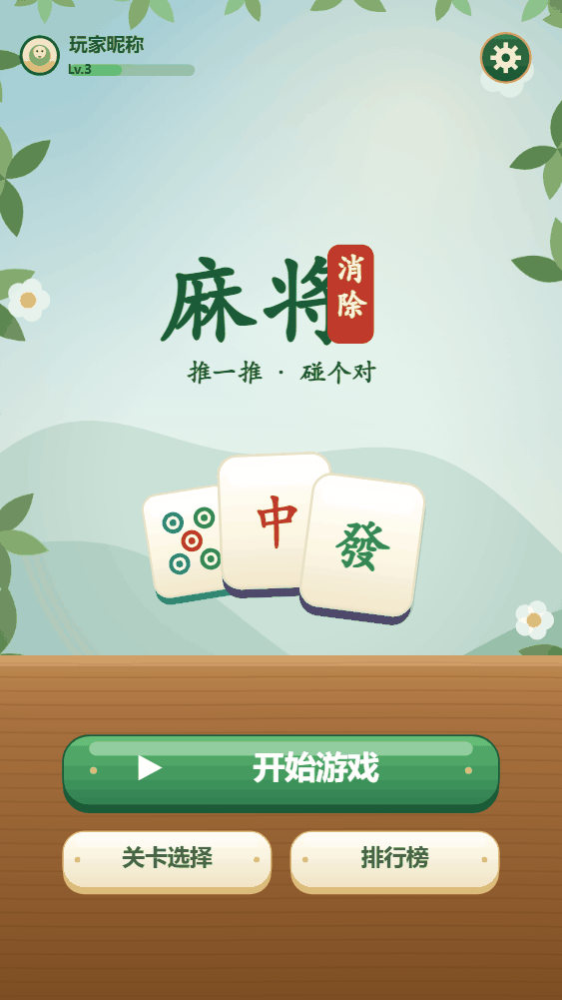
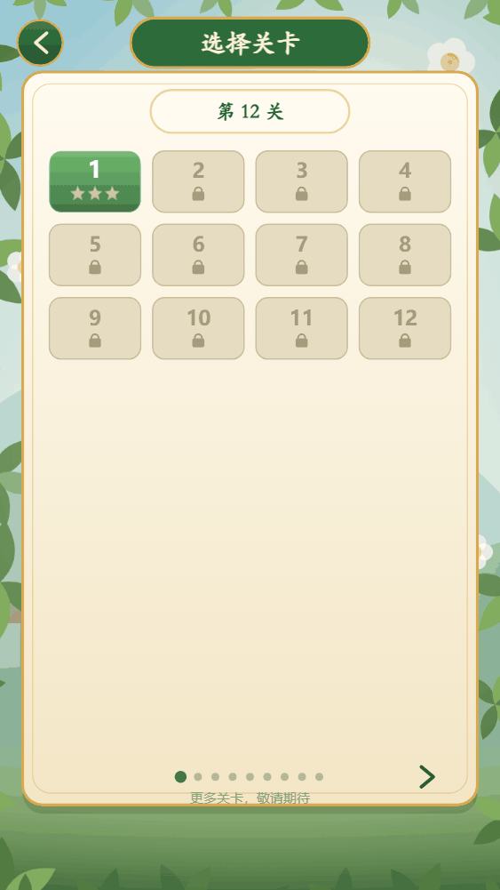
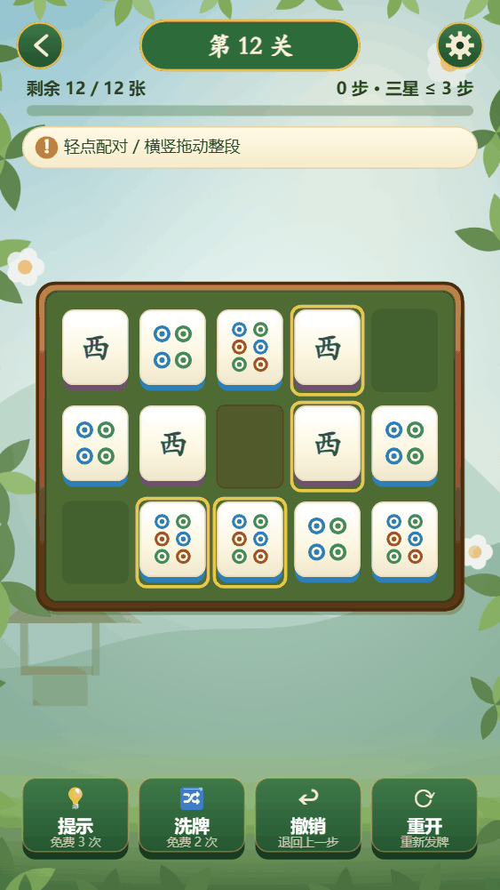
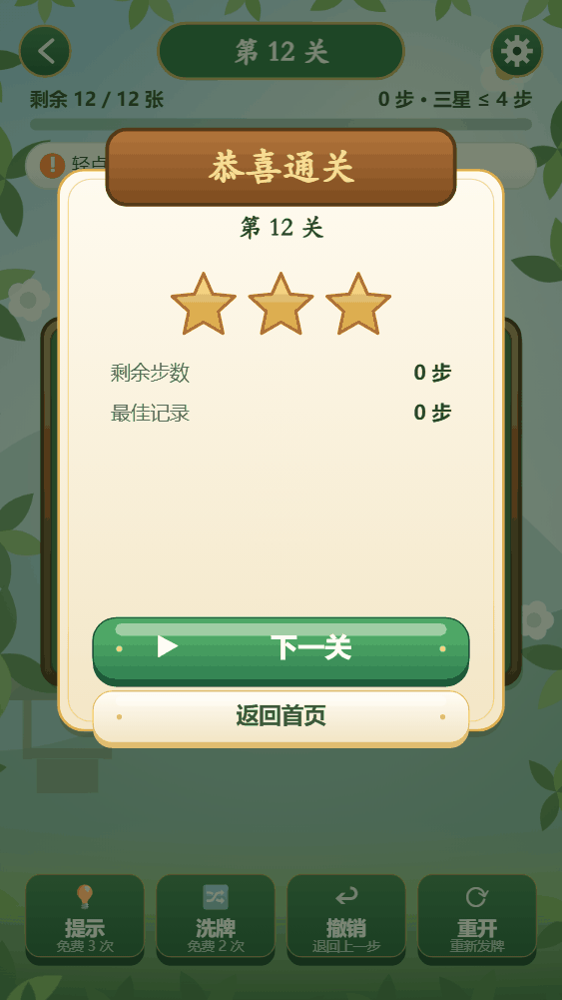
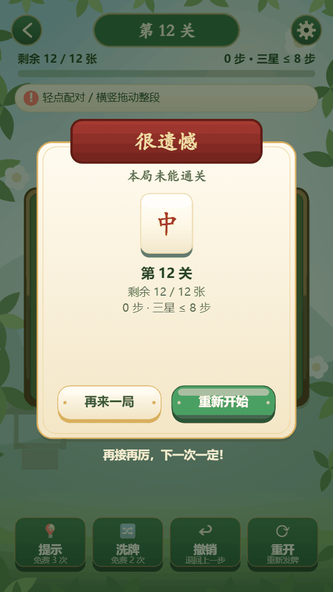
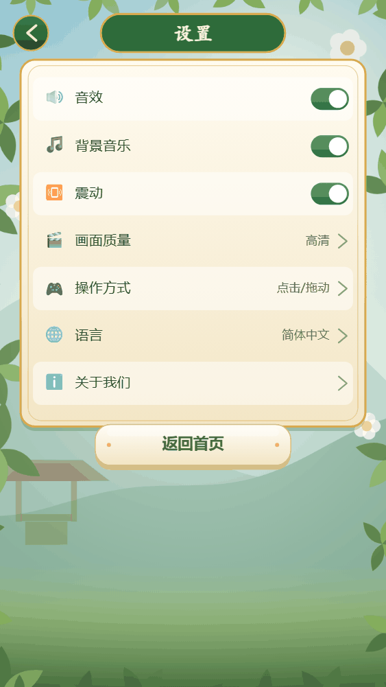
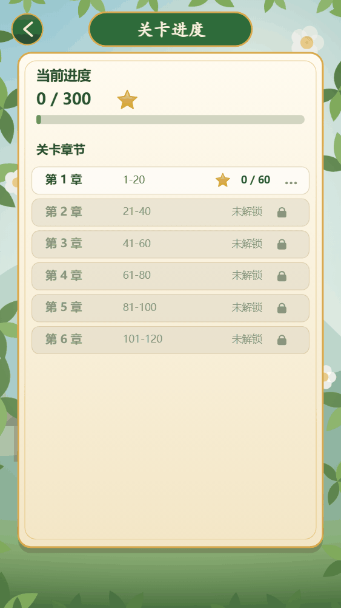
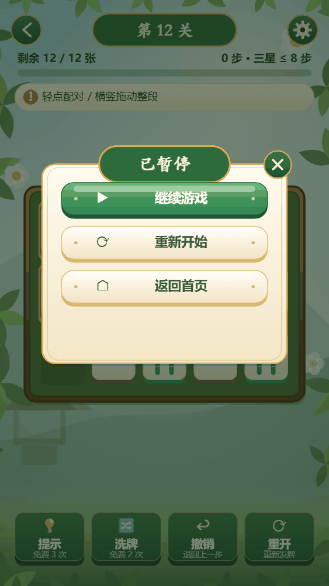

# 麻将消除 · H5 Demo

按 UI 设计稿（绿玉 / 中式庭院风）复刻的可玩 H5 版本。**规则、关卡、生成算法全部复用 `cocos/assets/scripts/core`**——
和微信小游戏构建用的是同一份核心代码，只是换了一层 Canvas2D 的皮。

## 界面一览

| 首页 | 选择关卡 | 牌桌 | 恭喜通关 |
|---|---|---|---|
|  |  |  |  |

| 很遗憾 | 设置 | 关卡进度 | 已暂停 |
|---|---|---|---|
|  |  |  |  |

## 运行

```bash
npm run demo:build     # 打包成单文件 demo/h5/index.html
npm run demo           # 起静态服务：http://127.0.0.1:8090/（同时打印局域网地址，手机同 Wi-Fi 可直接开）
npm run demo:watch     # 改 src/*.ts 自动重打包
npm run demo:check     # TypeScript 严格模式类型校验
npm run demo:test      # Playwright 端到端：真实点击/拖动，45 项断言
```

`index.html` 是自包含的（脚本内联，无外部依赖），直接双击也能玩；但**存档需要 localStorage**，
用 `file://` 打开时部分浏览器会禁用存储，建议走 `npm run demo`。

### 直达某个界面（方便看稿 / 截图）

`?screen=<home|levels|board|settings|progress|win|lose|pause|help>&level=<0-99>`

例：`http://127.0.0.1:8090/?screen=board&level=11`

## 已实现

| 界面 | 内容 |
|---|---|
| 首页 | 左上角进度摘要（第 N 关 + ★ X/300，全部取自真实存档）、齿轮、标题「麻将·消除」、副标题、三张装饰牌、开始游戏 / 关卡选择 / 我的进度 |
| 选择关卡 | 顶部「选择关卡」匾额、当前关卡胶囊、4 列关卡网格（已解锁绿卡 + 星级 / 未解锁灰卡 + 锁）、翻页圆点 |
| 牌桌 | 关卡标题、剩余牌数 + 进度条、步数与三星线、提示横幅（左侧玉色竖条）、木框牌桌、牌面绘制、叠层角标、可消对高亮、拖动实时预览、底部四个工具按钮 |
| 恭喜通关 | 木牌横幅、三颗星、剩余步数 / 最佳记录、下一关 / 返回首页 |
| 很遗憾 | 红绸横幅、本局未能通关、残局信息、再来一局 / 重新开始 |
| 设置 | 音效 / 背景音乐 / 震动开关、玩法说明、返回首页 |
| 我的进度 | 总星数 + 进度条、100 格星图（按星数着色，已解锁的格子可直接点开）、图例、已通关数 |
| 已暂停 | 继续游戏 / 重新开始 / 返回首页 |

交互与规则（**直接调用 core**，没有另写一套）：

- 轻点相邻同牌消除；点一张牌时若只有一个搭子会自动配对，多个搭子会提示选择。
- 按住一行横拖、一列竖拖，整段循环滑动；拖动过程中被拖动的牌实时跟手，松手结算并自动连消。
- 木块 `#` / 空洞 `.` 会截断滑轨；锁轨方向拖不动会给出提示。
- 提示 / 洗牌 / 撤销 / 重开；提示与洗牌各有免费次数，用辅助最多两星（评级逻辑来自 `Session.rating`）。
- 通关判定、星级、`maxLevel` 解锁、断点续局全部走 `Session` + `localStorage`。
- 无法消除且经搜索判定为死局时自动弹出「很遗憾」（只在小盘面上扫描，避免卡顿）。

## 目录

```
demo/h5/
  src/
    theme.ts     设计令牌（色板 / 字体），与 template.html 的 CSS 对应
    icons.ts     线描矢量图标（音效 / 音乐 / 震动 / 玩法 / 提示 / 洗牌 / 撤销 / 重开 / 播放 / 首页）
    tile.ts      牌面绘制：筒 = 点阵、条 = 竖条（一条为鸟）、万 = 数字 + 萬、字 = 汉字
    bg.ts        程序化背景：天空渐变、远山、亭子、枝叶花枝边框（带缓存）
    ui.ts        通用控件：圆角面板、厚按钮、匾额胶囊、开关、星、锁、箭头
    app.ts       应用外壳：屏幕状态机、命中测试、拖动控制、各界面绘制
    entry.ts     入口：建 App 并暴露 window.mj（供测试驱动）
  template.html  单文件模板，构建时把打包结果内联进 /*__BUNDLE__*/
  build.cjs      用 cocos 里的 esbuild 打包成 index.html
  serve.cjs      静态服务（含局域网地址，便于手机查看）
  tests/e2e.py   Playwright 端到端断言
  index.html     构建产物（已提交，双击即可看）
```

## 与正式版的关系

这里只做「看得见、点得动」的验证：**规则与关卡是正式的，视觉是 Canvas2D 手绘的近似稿**。
正式小游戏仍是 Cocos Creator 构建（`npm run build:wechat`），本目录不参与微信构建，也不影响主包体积。
核心逻辑若改动，两边会同时生效——这正是复用 `core/` 的意义。

## 已知差异（有意为之）

- 背景是程序化绘制的意境图，不是美术资源；正式版接图后会更细腻。
- 音效 / 背景音乐开关只记状态，Demo 不加载音频。
- 界面零美术资源：图标全部是 `icons.ts` 里的线描矢量图，**不用 emoji**（emoji 的字形与配色由系统字体决定，各平台不一致，且会破坏整套中式配色）。
- 「我的进度」的星图与设置页只呈现真实存在的数据与功能；不放点了没反应的占位项。