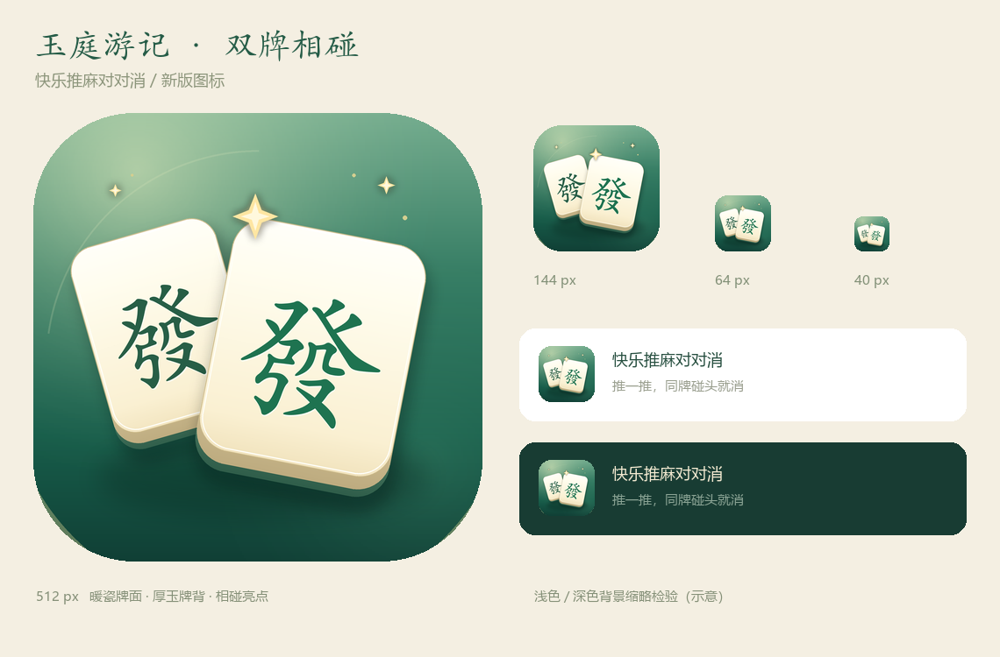

# 玉庭游记 · 新版小游戏图标

2026-11-05，为“快乐推麻对对消”全面改版配套。

**设计：两张相同的「發」牌相碰，暖瓷正面、厚玉牌背、深浅青玉背景，用相碰位置的暖金亮点表达消除。** 字牌和新界面的麻将语言一致，图标不塞游戏长标题，40px 缩略仍保留麻将牌的轮廓与字形。



## 交付文件

| 文件 | 尺寸 | 用途 |
| --- | --- | --- |
| `icon-jade-pair-1024.png` | 1024×1024 | 全彩母版 |
| `icon-jade-pair-512.png` | 512×512 | 常用平台素材，文件控制在 200KB 以内 |
| `icon-jade-pair-144.png` | 144×144 | 小尺寸头像素材 |
| `icon-jade-pair-256.png` / `128.png` / `64.png` / `40.png` | 对应像素尺寸 | 预览与其他使用场景 |
| `icon-rounded-preview.png` | 512×512，RGBA | 圆角展示预览；透明四角 |
| `icon-preview-sheet.png` | 1140×750 | 大图、144/64/40px 及浅深背景检查 |

`icon-jade-pair-*` 是满幅、不透明的方形 PNG，平台可按自身形状裁切。应根据实际后台的尺寸提示选择文件；圆角展示图不替代方形母版。

## 制作方式与重生成

沿用项目原有 Pillow 原生图标管线，输出实际 PNG，不调用外部图片 API。当前会话没有可用的内置生图工具，未切换至需要密钥的 API 备用模式。

可编辑源文件：`cocos/tools/make-icon-v2.py`。

```powershell
python cocos/tools/make-icon-v2.py
npm run redesign:build
```

字体使用 Windows 华文楷体与微软雅黑。其他系统重生成时需在脚本顶部设置对应字体路径。

设计输入摘要：

> 小游戏图标，与玉庭游记界面配套；保留麻将识别度，用同牌相碰表达消除。暖瓷牌面、青玉厚边、柔和接触阴影、金色小亮点；主体占主要面积，40px 能认出。只保留牌面文字「發」，不用长标题、硬币或复杂场景。

已接入可交互设计稿的品牌标记和浏览器图标。旧版 `docs/brand/icon-*.png` 全部保留。微信后台头像未在本次本地设计过程中修改。
