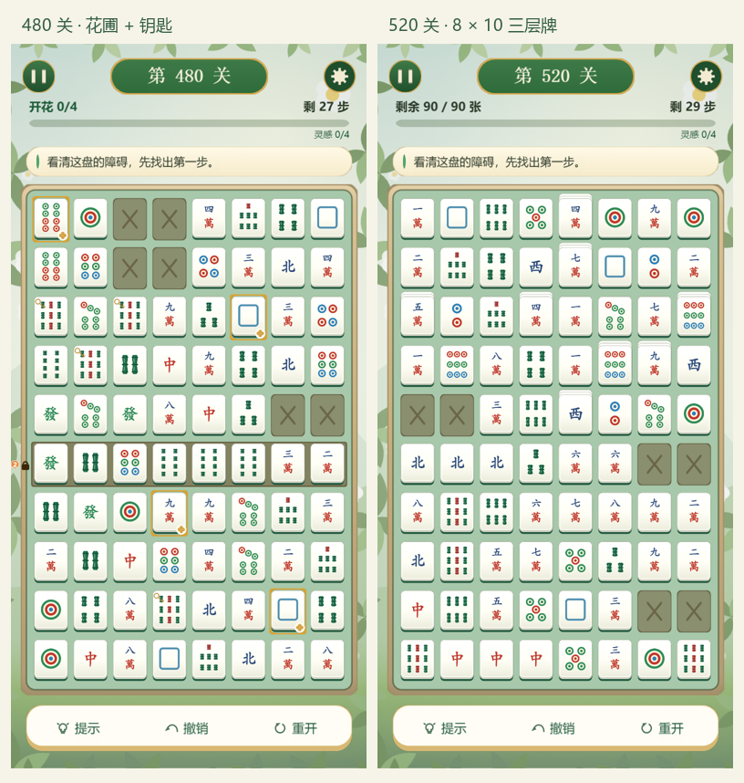

# 520 关实现与验证

2026-11-05。当前实现位于 `codex/mahjong-redesign`，麻将身份及备案名称保持不变。

- 正式主线 520 关 / 26 章，尺寸从 4×3 到 8×10，大小盘与休息关交替。
- 花圃、邻格浇水、两次花苞、钥匙开轨、四对充能已接入真实规则、存档、撤销、提示与界面。
- 叠层、冰与厚冰、木块、缺口、单向轨、固定锁、计数解锁、百搭和爆竹保留；番型禁消限制移出主线。
- Cocos 与 H5 共用正式关卡和实体牌面，底部为三项紧凑工具；本地两首音乐与 12 个音效已接入。
- 旧关号进度与设置保留；旧成绩和旧牌桌归档，不覆盖到新牌局。无服务器，无广告 SDK。

## 验证结果

| 验证 | 结果 |
|---|---|
| `npm test` | 156 项规则/会话/生成/存档测试 + 4 项压力测试通过，Cocos 严格类型检查通过。 |
| 520 关逐关回放 | 每关固定盘面指纹一致；通过真实 Session、动态锁与目标判断，无参考路线超步数。 |
| `npm run demo:check` | H5 类型检查通过。 |
| `npm run demo:test` | 49 项真实点击、拖动、导航与存档相关断言通过。 |
| `python demo/h5/tests/campaign.py` | 320×568、390×844、430×932；六种代表关通过几何检查，并用真实鼠标操作完整通关。 |
| 同脚本 `--native --url http://127.0.0.1:7456/` | 同三种视口、六种关卡；实际触摸完成每关前 3 步，无运行时错误或图集缺失。 |
| Cocos 音频 | 首次触摸解锁、音乐/音效独立开关、设置重载、引擎 hide/show 暂停恢复通过；无加载失败。 |
| 旧五模式设计稿 | 11 项模型测试及类型检查通过。 |
| `npm run build:wechat` | 编辑器扩展构建成功，主包 3,535,631 字节（3.37 MiB），包含 14 个本地音频资源。 |

微信包已生成，未上传体验版。系统静音、耳机/外放听感、真实低端手机表现与难度曲线仍需玩家实测。引擎随包一起提供，当前体积低于 4 MiB。

## 查看结果

- [玩法与章节安排](CAMPAIGN-520.md)
- [520 关全量表](../关卡全量表.md)
- [Cocos 原生预览截图](campaign-preview.png)
- `npm run demo`：当前可玩的 H5 主线；参数 `?screen=board&level=519&preview=1` 可直达第 520 关。
- `npm run author:levels --prefix cocos` 重建确定性关卡表，`npm run export:table --prefix cocos` 同步文档。

