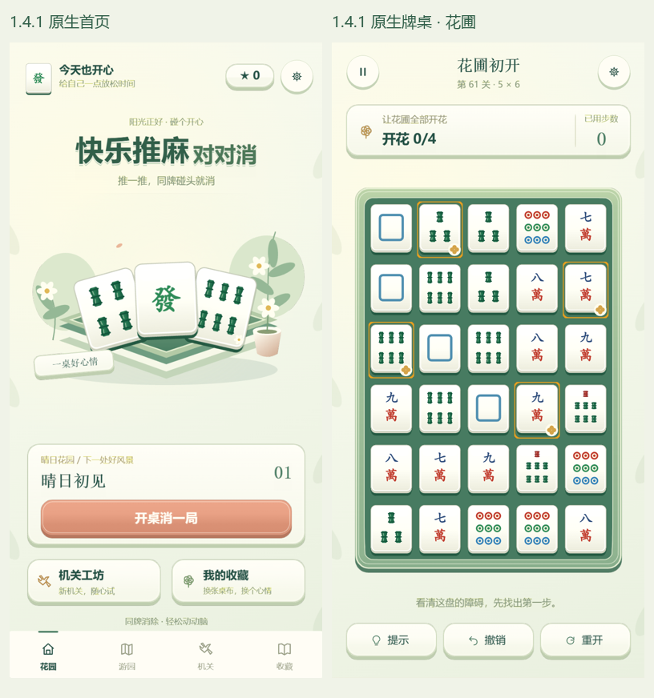

# 晴日花园 UI 正式落地

2026-11-05 · 1.4.1

1.4.0 已上传 520 关玩法，但仍使用旧版首页、牌桌和选关布局。这次补齐此前确认的晴日花园界面；继续保留麻将身份、备案名称、正式主线及独立挑战。

## 界面

- 首页：乳白麻将、白花与青绿托盘主视觉，立体字标、当前关卡纸卡、杏桃色开桌按钮。首次进入回到花园首页，继续按钮保留未完成的牌局。
- 牌桌：奶油色目标卡、实际牌面收集清单、青绿绒面与圆角厚边；下方仅「提示 / 撤销 / 重开」。短屏大盘压缩顶栏，保留麻将的宽高比例。
- 游园：26 章、每章 20 个节点的连续路线，显示关号、星数与开放状态，前后章节均可浏览，锁关不能进入。
- 工坊：8 个机关试玩入口，使用真实关卡及 Session；试玩会话不写主线存档，离开恢复原牌局。正式 Cocos 保留独立挑战入口；H5 沿用原有能力范围，在该位置提供玩法说明。
- 收藏：显示已到访章节的花笺，提供雨后薄荷、月下青瓷、杏桃夕照三张桌布；分别需要 0 / 20 / 60 颗星。使用状态本地保存。
- 弹窗：设置、章首提示、暂停、重开确认、成功和失败均使用同一套纸卡、短文案与按钮。

`sunnyLayout.ts` 提供主界面的共用几何与文案；`sunnyArt.ts` 提供共用画法。原生由 `SunnyView.ts` 使用固定图集与可点击节点装配，H5 由 `demo/h5/src/sunny.ts` 渲染。复用原有 Board 节点池；背景图集中移除已不再使用的整屏木桌，新增 UI 不会每次操作重新烘焙纹理。

## 验证

- 156 项核心/会话/关卡等测试及 4 项压力测试通过。
- Cocos 与 H5 类型检查通过；6 项视图/构建转译防回归检查通过。
- H5 原有 49 项交互检查通过。
- 新增 `python demo/h5/tests/sunny.py`，可加 `--native` 检查原生：实际点击导航、音频开关、重开确认、主线继续、工坊隔离和桌布切换；检查 320×568、390×844、430×932 的控件边界。
- 六种代表关的两端实操检查覆盖花圃、露珠、钥匙、花苞及 480 / 520 关；H5 逐步通关，Cocos 使用实际触摸执行参考路线。

本地预览和自动测试不能替代真机听感、低端手机显存表现及真人难度测试。

## 发布

2026-11-05 14:34，已通过 `wechat-minigame-release` 技能上传 **1.4.1 / CI 机器人 1**。微信成功回执 `__FULL__` 为 3,511,065 字节；本地构建 57 个文件、3,538,746 字节（3.37 MiB），构建编号 `rebuild-1793859930725`。本次为未加固的功能体验包，未提交正式审核。

