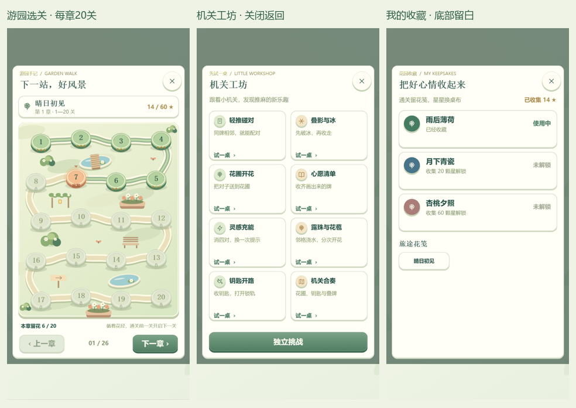

# 1.4.3 游园选关与入口面板

游园选关、机关工坊、我的收藏统一为可关闭的面板，取消底部导航。面板下沿与首页共用横幅预留区，本次没有接入广告 SDK。

## 地图与性能

- 保留“上一章 / 下一章”按钮：每页 20 关，共 26 章；正式版也可以浏览后续章节。
- 弯曲石径、池塘、小桥、花架、花坛、园椅、路牌、蝴蝶与章节配色；立体花台区分已通关、当前关卡和锁定关卡。
- 原生只缓存当前章节的景物贴图，关卡底座复用已有图集；同章刷新复用纹理，翻章释放上一章纹理、帧和离屏画布。
- 图集诊断按实例登记、销毁时移除，避免同尺寸图集串用记录或翻章后误报未就绪。

## 正式与测试环境

- `isLevelUnlocked` 只读真实进度，决定锁定外观。
- `canEnter` 决定实际进入权限；仅 `trial` / `develop` 允许跳关，`release` 和未知环境按进度限制。
- 测试跳关通关不直接推进主线最高关卡；切回正式环境后“继续”和“下一关”不能绕过限制。
- 工坊仍用独立试玩会话，退出恢复原主线牌局。

## 验证

- `npm test`：159 项功能测试、4 项压力测试及 Cocos 类型检查通过，包含 520 关逐一验证。
- `npm run demo:check`：H5 类型检查通过。
- `python demo/h5/tests/sunny.py` 和 `--native`：320×568、390×844、430×932 三种尺寸，导航、关闭返回、设置、工坊隔离、收藏与桌布通过。
- `python demo/h5/tests/garden.py`：实际指针遍历 26 章首尾、正式版第 520 关拦截、体验版点击进入、返回原牌桌/首页；原生同章纹理复用，连续翻章的有效图集数量保持不变，所有纹理状态正常。
- 截图来自 Cocos 原生浏览器预览。低端实体手机的帧率需要真机验证，本次性能验证覆盖了分页数量、纹理复用与资源释放。

